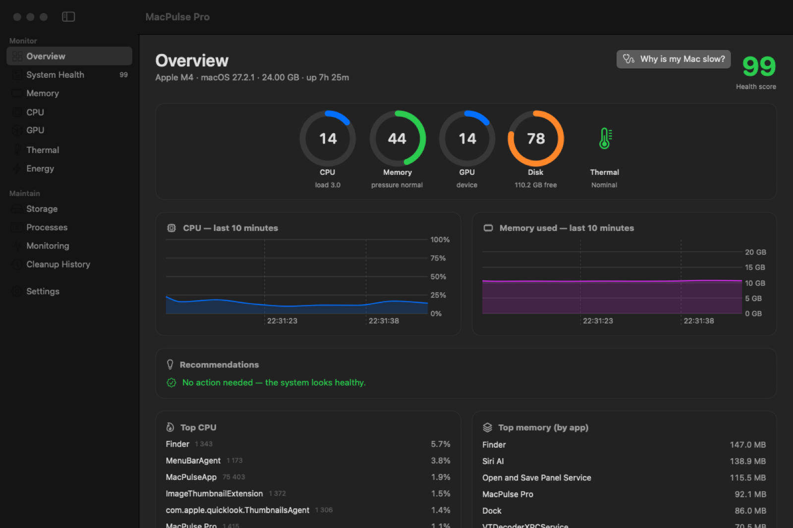
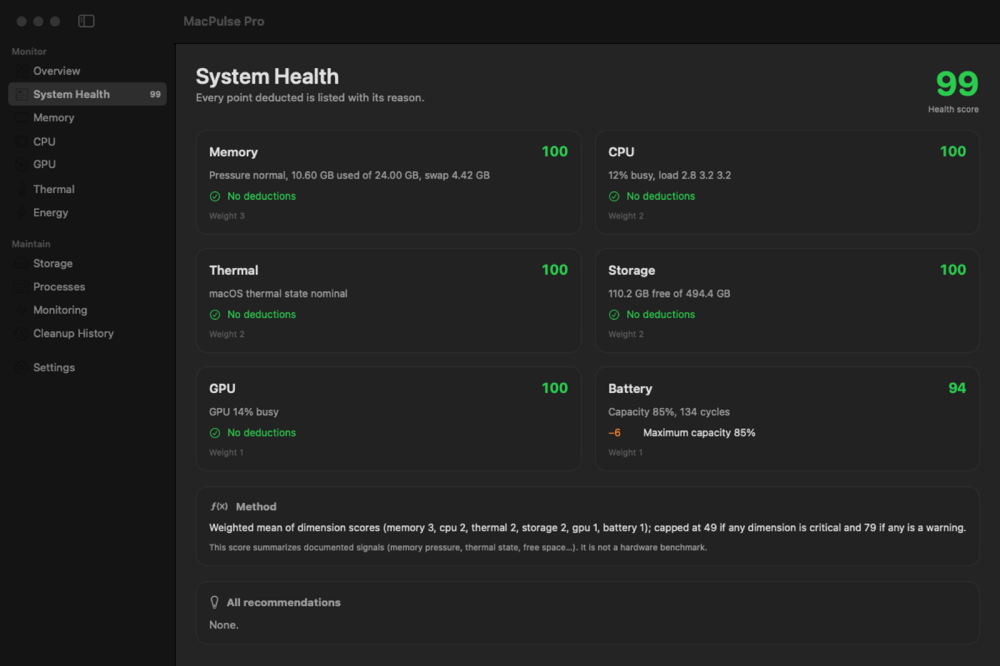
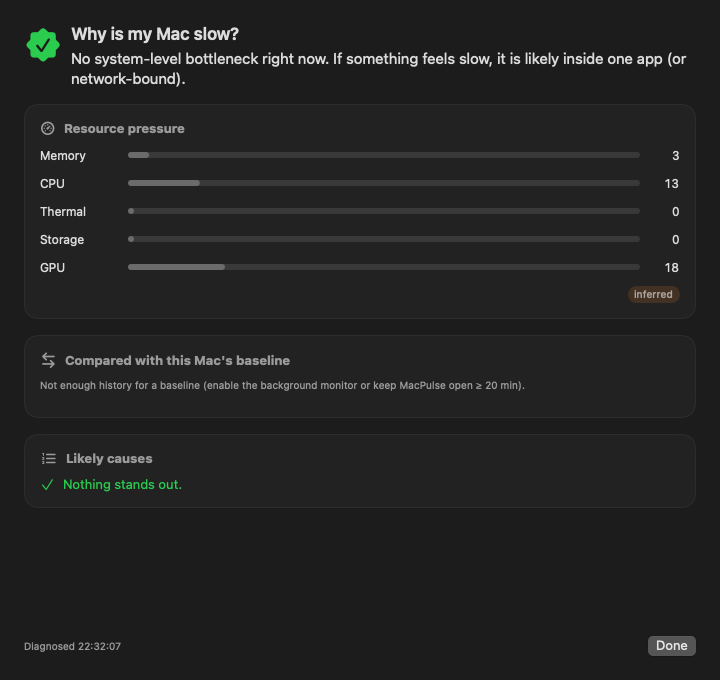
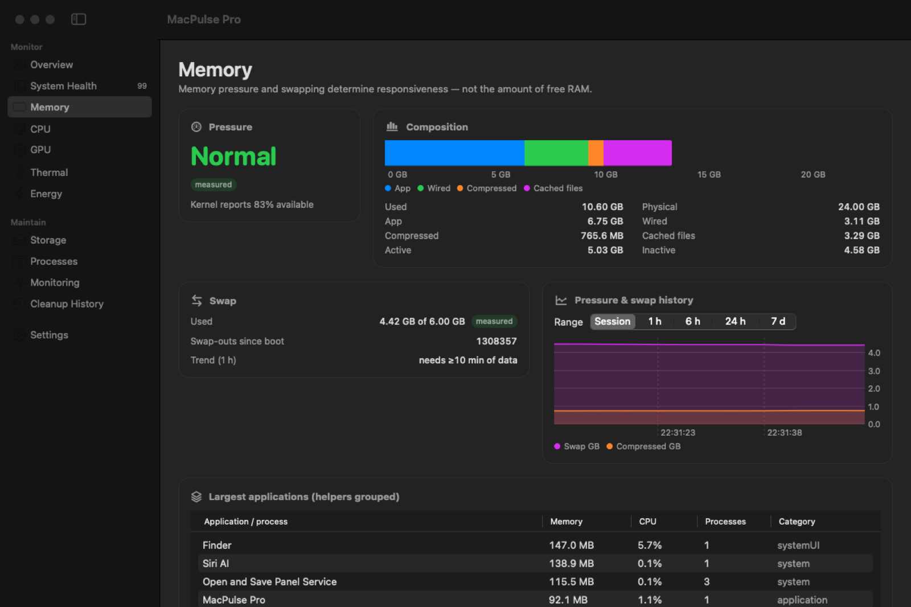
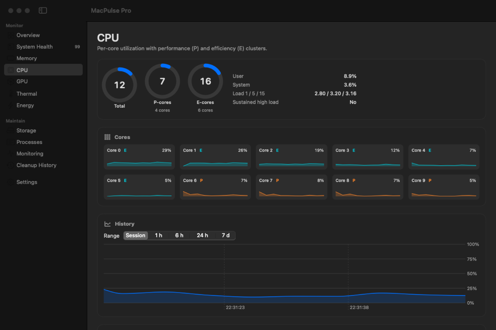
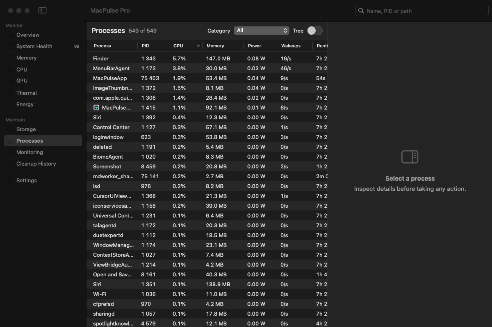
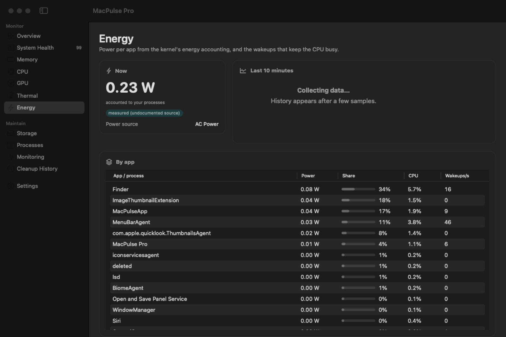
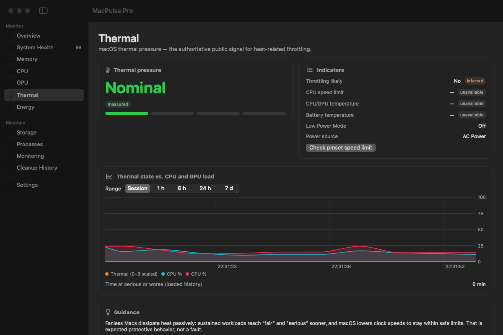
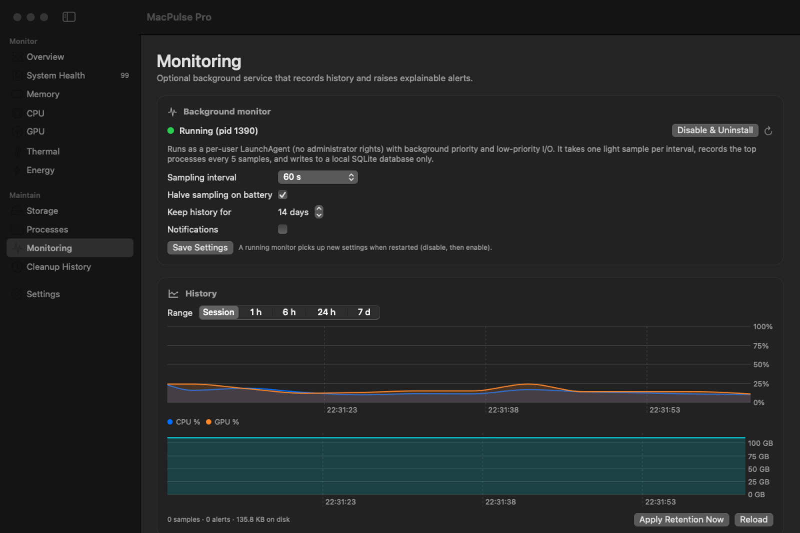

# MacPulse Pro

[](https://github.com/JustKrisCode/MacPulsePro/actions/workflows/ci.yml)


[](LICENSE)

A native macOS system monitor, diagnostics tool and **safe** optimizer, built with Swift 6 and SwiftUI.
It measures what macOS actually exposes, labels every value with its provenance (measured, estimated, inferred or
unavailable), and never deletes or terminates anything without validated, explicit confirmation.



- **SwiftUI app** with 11 sections, Swift Charts history, dark and light mode, and keyboard shortcuts
- **Menu bar companion** showing configurable live metrics
- **`macpulse` CLI** with the same engine and safety logic as the app, plus JSON output and exit codes for scripting
- **Opt-in background monitor** (a per-user LaunchAgent), SQLite history with retention, and explainable alerts
- No third-party dependencies, no network access, no administrator rights

### What sets it apart

- **"Why is my Mac slow?"** (`macpulse why`, ⌘Y in the app) finds the current bottleneck, compares the present with
  your Mac's own baseline from its history, and names the specific causes with evidence: CPU-heavy apps, memory
  hogs, swapping, heavy processes started recently, memory growth, heat, GPU-heavy tabs, wakeup storms.
- **Energy per app**: power (W) per process and per app from the kernel's energy accounting, plus CPU wakeups per
  second. It answers "what is draining my battery?" without `sudo powermetrics`.
- **Disk growth tracking**: measured folder sizes over time, including swap files, so "where did my free space
  go?" has a measured answer. Rescans are incremental through the FSEvents journal: only changed folders are
  walked again (seconds instead of minutes), with a full rescan whenever the journal cannot answer reliably.
- **Top offenders this week** (`macpulse offenders`, Monitoring): which apps heated the Mac, filled memory under
  pressure, drew the most energy or woke the CPU most often, from the monitor's history.
- **Smarter alerts**: sustained wakeup storms (≥1000/s for 30 min) and energy hogs on battery (≥2 W for 30 min),
  and swap-growth alerts that name the largest app.
- **Automatic cleanup (opt-in)**: on a schedule, removes only SAFE, rebuildable caches and old logs that have been
  idle for at least 24 h and whose apps are not running. Every item still passes the full validation chain and is
  written to the audit log. Turn it on in Settings or with `macpulse autoclean enable`.
- **Workload gate**: `macpulse run --when-ready -- make build` starts a heavy job only once the Mac is cool, memory
  pressure is normal and the CPU has headroom. This is useful on fanless Macs, where overlapping heavy jobs throttle
  each other.

## Screenshots

| | |
|---|---|
|  |  |
| **System Health**: every deducted point is listed with its reason | **Why is my Mac slow?** (⌘Y): bottleneck, baseline and named causes |
|  |  |
| **Memory**: pressure, composition, swap and the largest apps | **CPU**: per-core load split into P- and E-cores, with history |
|  |  |
| **Processes**: inspect before acting, PID-reuse-safe termination | **Energy**: watts per app and wakeups per second |
|  |  |
| **Thermal**: thermal pressure against CPU and GPU load | **Monitoring**: opt-in background history and alerts |

## Quick start

```sh
git clone https://github.com/JustKrisCode/MacPulsePro.git
cd MacPulsePro
scripts/build-app.sh      # release build → build/MacPulse Pro.app
scripts/install.sh        # installs the app and the `macpulse` CLI, no sudo
open ~/Applications/MacPulse\ Pro.app
macpulse status           # make sure ~/.local/bin is on your PATH
```

**First launch.** The app is ad-hoc signed, not notarized, because it is built on your own Mac. If macOS still
refuses to open it, right-click the app in Finder and choose **Open**, or allow it in *System Settings › Privacy &
Security*. MacPulse needs no special permissions to monitor; it asks for nothing at launch.

**Keyboard shortcuts.** ⌘1–⌘9 switch sections, ⌘Y runs "Why is my Mac slow?", ⌘R refreshes, ⇧⌘E exports a report
(Markdown, JSON, CSV or HTML).

**Typical uses**

- *"My Mac feels slow"*: open the app and press ⌘Y, or run `macpulse why` in a terminal.
- *"What drains my battery?"*: the Energy section, or `macpulse energy`.
- *"Where did my disk space go?"*: Storage › Growth, or `macpulse disk growth --scan`, then the same command a few
  days later.
- *"Free up space safely"*: Storage › Cleanup › Analyze. Everything is read-only until you select items and confirm
  them. You can choose Trash instead of permanent deletion, and every action is written to Cleanup History.
- *"Keep an eye on things over time"*: Monitoring › enable the background monitor (one light sample per minute, local
  SQLite only).

## Requirements

- macOS 14 or later (developed and tested on macOS 27.2, Apple M4)
- Xcode 16+ / Swift 6 toolchain to build

## Build, test, install

```sh
swift test                      # 117 tests: safety, parsers, analysis, persistence, live collectors, overhead
scripts/build-app.sh            # → build/MacPulse Pro.app  (bundles the CLI at Contents/MacOS/macpulse)
UNIVERSAL=1 scripts/build-app.sh  # arm64 + x86_64 (Intel)
scripts/install.sh              # → ~/Applications/MacPulse Pro.app and ~/.local/bin/macpulse (no sudo)
```

During development: `swift run macpulse status` or `swift run MacPulseApp`.
Set `MACPULSE_HOME=/some/dir` to keep history and config out of `~/Library/Application Support`.

## Uninstall

```sh
scripts/uninstall.sh              # stops/removes the monitor, the app and the CLI link; keeps history
scripts/uninstall.sh --purge-data # also deletes history, configuration and logs
```

Manual equivalent: `macpulse monitor uninstall`, delete `~/Applications/MacPulse Pro.app`, `~/.local/bin/macpulse`,
`~/Library/Application Support/MacPulsePro` and `~/Library/Logs/MacPulsePro`.

## CLI

```text
macpulse status                     health score, key metrics, top processes, warnings (exit 3 if warnings)
macpulse doctor                     metric availability matrix, permissions, collector overhead
macpulse cpu | memory | gpu | thermal | battery
macpulse monitor [--interval 2]     live terminal dashboard
macpulse monitor install|uninstall|status|run
macpulse history [--hours 24] [--metric cpu] [--csv]
macpulse events                     recorded alerts
macpulse recommend [--with-storage] ranked, evidence-based recommendations
macpulse why                        why is my Mac slow? bottleneck, baseline comparison, named causes (exit 3 if a bottleneck)
macpulse energy [--sample 3]        power per app (W) and CPU wakeups
macpulse ready [--cpu 60] [--allow-fair]       exit 0 if there is headroom for heavy work, 10 if not
macpulse run --when-ready [--max-wait 30m] [--run-anyway] -- COMMAND ARGS…   start a job once the Mac is ready
macpulse disk growth [--scan] [--full] [--since 7d] [--personal]  what grew on disk (incremental via FSEvents)
macpulse offenders [--days 7]       which apps heated the Mac, filled memory, drew energy, woke the CPU
macpulse autoclean [status|enable|disable|preview|run] [--every 7] [--mode delete|trash] [--categories …]
macpulse disk analyze [--personal]  categorized candidates with IDs (read-only)
macpulse disk clean --select ID,ID  dry run (default)
macpulse disk clean --select ID,ID --mode trash|delete --apply   validated cleanup after confirmation
macpulse disk clean --all-safe ...  every SAFE, unblocked item
macpulse disk large [PATH] [--min-size 2GB]
macpulse disk duplicates PATH
macpulse disk history               cleanup audit log
macpulse processes [--sort cpu|memory|energy|wakeups|runtime] [--filter TEXT] [--limit N]
macpulse processes tree [--pid PID]
macpulse processes inspect PID
macpulse processes terminate PID [--force]
macpulse report --format markdown|json|csv|html --output FILE [--with-storage]
macpulse config show | set KEY VALUE | path | reset
```

Global options are `--json`, `--no-color` (`NO_COLOR` is also honored) and `--yes` for non-interactive confirmation.
Exit codes: `0` ok, `1` failure, `3` warnings or bottleneck present, `10` not ready (`ready`), `64` usage error, `69` unavailable, `75` busy (a cleanup is
already running), `77` refused by the safety policy or by permissions. With `--json`, errors are printed as
`{"error":{"code","message"}}`.

## Configuration

`~/Library/Application Support/MacPulsePro/config.json`. Keys missing from the file use their defaults, and
out-of-range values are clamped.

| Key | Default | Meaning |
|---|---|---|
| `sampleIntervalSeconds` | 60 | Background monitor interval (minimum 10) |
| `processSampleEvery` | 5 | Record top processes every N samples |
| `reduceSamplingOnBattery` | true | Double the interval on battery |
| `retentionDays` / `maxSampleRows` | 14 / 100000 | History limits (cleanup audit log: 365 days) |
| `notificationsEnabled` | false | Alert notifications (opt-in) |
| `notificationCooldownMinutes` | 60 | Minimum gap between alerts of the same kind |
| `uiRefreshSeconds` | 2 | App refresh while the window is open |
| `autoClean.enabled` / `intervalDays` / `mode` | false / 7 / delete | Scheduled SAFE cleanup (opt-in) |
| `autoClean.categories` | `["developerCache","logs"]` | Allowed: `developerCache, logs, browserCache, applicationCache` |
| `autoClean.minIdleHours` / `minItemBytes` | 24 / 10 MB | Skip recently used or tiny items |
| `menuBarMetrics` | `["cpu","memory"]` | Any of `cpu, memory, gpu, swap, thermal, disk` |
| `thresholds.*` | see `macpulse config show` | Low disk, swap growth, sustained CPU, runaway process, memory growth |

Example: `macpulse config set thresholds.lowDiskFreePercent 12`

## Measured overhead (Apple M4, release build)

| Scenario | CPU | Memory |
|---|---|---|
| Light sample (monitor tick, no process table) | ~15–20 ms per sample | — |
| Full sample incl. ~800 processes | ~25–80 ms per sample | — |
| CLI live monitor, 2 s interval, full process table | ~2% of one core | ~25 MB |
| App window open on Overview, 2 s refresh | ~1.5% of one core (A/B: 70% less than 1.0) | 60–120 MB footprint (graphics buffers fluctuate) |
| App window covered/minimized, or menu bar only | refreshes ≤ every 5 s, process table every 6th tick | — |
| Background monitor, 60 s interval | <0.1% of one core | one SQLite row per minute |

Run `macpulse doctor` to see the per-collector timings on your own machine, `scripts/bench-app.sh [section]` to measure
the app, and `MACPULSE_PROFILE=1` to log per-phase timings of every refresh.

## Known limitations

See [docs/METRICS.md](docs/METRICS.md) for the full matrix. In short:

- **CPU and GPU die temperatures are not shown.** They require private SMC/HID interfaces. The thermal *state*
  from `ProcessInfo.thermalState` is the supported signal.
- **GPU utilization and per-process GPU time** come from IORegistry driver statistics (`IOAccelerator`
  `PerformanceStatistics` and the AGX user-client `AppUsage` counters). The values are real, but Apple does not
  document these interfaces, so they are labelled *measured (undocumented source)*. GPU power and per-process GPU
  memory need `sudo powermetrics` and are not collected.
- **Other users' processes** (root daemons) show no CPU or memory figures without root. MacPulse never asks for root.
- **APFS snapshot sizes** need root, so only snapshot names and dates are listed.
- **APFS clones**: tree sizes count allocated blocks per file, so cloned data can be overstated. Large-file and
  duplicate views use the clone-aware private size (`ATTR_CMNEXT_PRIVATESIZE`).
- Folders protected by macOS privacy controls (Safari, Mail, Trash, Downloads) are analyzed only when access is
  granted. MacPulse does not try to bypass these controls.
- **Per-app energy** is the kernel's own accounting (`ri_energy_nj`). It mostly covers CPU-side energy, so the
  total is lower than the battery's discharge rate (display, GPU and other devices are not fully attributed).
- **Disk-growth scans** read most of the home folder. The first scan can take a few minutes; privacy-protected
  folders are included only with `--personal`.
- **MetricKit** reports only the app's own daily diagnostics, so it is not used.
- Cache-ownership ("in use") detection matches bundle IDs and process names. A tool that runs as a generic
  interpreter (for example npm running as `node`) may not be detected; those caches are rebuildable by design.

## Documentation

- [Architecture](docs/ARCHITECTURE.md)
- [Metric availability matrix](docs/METRICS.md)
- [Safety and threat model](docs/SAFETY.md)
- [Health score method](docs/HEALTH_SCORE.md)

## Privacy

MacPulse Pro makes no network connections and collects no telemetry. All history, configuration and the cleanup
audit log stay in `~/Library/Application Support/MacPulsePro` (file mode 0600). Process arguments that look like
credentials are redacted before they are displayed, and reports never include process arguments.

## Contributing

Contributions are welcome. Please read [CONTRIBUTING.md](CONTRIBUTING.md), and report security issues privately as
described in [SECURITY.md](SECURITY.md). This project follows the [Code of Conduct](CODE_OF_CONDUCT.md).
Changes are listed in [CHANGELOG.md](CHANGELOG.md).

## License

[MIT](LICENSE) © 2026 Kristiyan Kiryazov.

MacPulse Pro is provided as is. It is designed to be conservative, but you are responsible for the cleanup and
termination actions you confirm.

